# Diploma-Thesis
<p align="center">
  <a href="https://github.com/robotics-4-all">
    
  </a>
  <a href="https://github.com/neo4j">
    
  </a>
  <a href="https://github.com/modelcontextprotocol">
    
  </a>
  <a href="https://github.com/srcML">
    
  </a>
  <a href="https://github.com/lxml">
    
  </a>
  <a href="https://github.com/Instagram/LibCST">
    
  </a>
  <a href="https://github.com/babel">
    
  </a>
  <a href="https://github.com/mongodb">
    
  </a>
  <a href="https://github.com/fastapi">
    
  </a>
</p>

## Overview

This repository contains the implementation of a fully automated system for **extracting and organizing domain knowledge from the source code of software repositories**. Through this process, a unified **Semantic Knowledge Graph** is produced, which can progressively integrate rich specialized knowledge across multiple heterogeneous thematic and technological domains. 

It was developed as part of my **Diploma Thesis** at the **School of Electrical and Computer Engineering**, [Aristotle University of Thessaloniki](https://ece.auth.gr/).

## Thesis Supervision

>Professor [Andreas Symeonidis](https://people.auth.gr/symeonid/)

>Dr. [Emmanouil Tsardoulias](https://etsardou.github.io/)

>PhD C. [Theodoros Tsampouris](https://issel.ee.auth.gr/member-details/?id=6672c16d6ea2617608b2af1c)

## 📑 Table of Contents
- [Abstract](#Abstract)
- [Methodology and Implementation](#Methodology-and-Implementation)
  - [Full System](#Full-System)
  - [Parsers](#Parsers)
    - [Python Parser](#Python-Parser)
    - [Java Cpp C Parsers](#Java-Cpp-C-Parsers)
    - [JavaScript Parser](#JavaScript-Parser)
    - [Result](#Parsers-Result)
  - [Concept Filter](#Concept-Filter)
    - [Result](#Concept-Filter-Result)
  - [Temporary Structural Graph](#Temporary-Structural-Graph)
    - [Intermediate File](#SG-Intermediate-File)
      - [Result](#SG-Intermediate-File-Result)
    - [SG Loader](#SG-Loader)
    - [SG Visualization](#SG-Visualization)
   - [Final Semantic Knowledge Graph](#Final-Semantic-Knowledge-Graph)
     - [Intermediate File](#KG-Intermediate-File)
       - [Result](#KG-Intermediate-File-Result)
     - [KG Loader](#KG-Loader)
     - [KG Default Visualization](#KG-Default-Visualization)
   - [Knowledge Graph Visualizer](#Knowledge-Graph-Visualizer)
     - [Better Visualization Examples](#Better-Visualization-Examples)
   - [KG parsers API](#KG-parsers-API)
   - [Scraper](#Scraper)
   - [Automated Request Generator and Dispatcher](#Automated-Request-Generator-and-Dispatcher)
   - [MCP Service](#MCP-Service)
     - [Server](#Server)
     - [Ariadne API](#Ariadne-API)
     - [Client](#Client)
- [Full System Execution](#Full-System-Execution)
- [Experimental Validation](#Experimental-Validation)
  - [Experiment](#Experiment)
  - [Subjective Evaluation](#Subjective-Evaluation)
    - [Results](#Subjective-Evaluation-Results)
  - [Objective Evaluation](#Objective-Evaluation)
  - [Conclusion](#Conclusion)
- [Future Work](#Future-Work)

## Abstract
In the era of rapid software development, millions of open-source repositories are hosted on
platforms such as GitHub and GitLab, incorporating a significant volume of specialized
knowledge across a wide variety of domains. The exploitation of this knowledge can
lead to the automated generation of functional requirements (FRs) for Domain-Specific
Languages (DSLs).

The generation of functional requirements has traditionally relied on domain experts
and remains largely manual to this day. Large Language Models (LLMs) can contribute
to the automation of this process; however, without access to rich structured domain
knowledge they tend to produce generic or insufficiently specialized requirements.
Within the context of the present thesis, an automated mechanism for extracting
and organizing domain knowledge from open-source repositories was developed. More
specifically, parsers were implemented for five programming languages (Python, Java,
JavaScript, C, C++) with the aim of extracting the names and the basic characteristics
of the structural elements of the code, such as classes, functions, and libraries. Although
these elements are often treated as implementation details, their names largely reflect the
domain of the software. Therefore, their extraction becomes necessary.

After the collection of the information, a cleaning process is applied, which retains
only the concepts directly related to the domain of the analyzed software project. The
cleaned data initially form a Structural Graph, which describes the static structure of
the code and the programming relationships between its elements. Subsequently, the
Structural Graph is transformed into the final Knowledge Graph that preserves only the
information related to the project’s domain.

The application of this mechanism to multiple and heterogeneous open-source repositories 
can produce a unified Semantic Knowledge Graph with rich domain knowledge from
various domains. Finally, the Model Context Protocol (MCP) is utilized, through which
the Large Language Model Claude gains access to the structured knowledge incorporated
in the Semantic Graph, resulting in the formulation of sufficiently specialized functional
requirements for various DSLs.

## Methodology and Implementation
Initially, [Parsers](#Parsers) were implemented for five programming languages (Python, Java, JavaScript, C, and C++), with the aim of performing static analysis on the source code of repositories. Subsequently, the [Concept Filter](#Concept-Filter) isolates the results of the static analysis that may carry knowledge relevant to the domains of the repositories. Next, the [Structural Graph (SG)](#Temporary-Structural-Graph) is constructed, representing the filtered results in graph form. Each node and edge of the SG is assigned an appropriate weight, reflecting their importance with respect to domain knowledge extraction. Following this, the SG is transformed into the [final Knowledge Graph (KG)](#Final-Semantic-Knowledge-Graph), which is stripped of the details of static analysis and retains only pure domain knowledge. Thus, each node in the KG represents a unique domain concept, while the weights of the relationships capture the significance of the combination of two domain concepts. Immediately afterward, the [Knowledge Graph Visualizer (KG Visualizer)](#Knowledge-Graph-Visualizer) produces a high-quality visualization of the KG, highlighting the most dominant nodes and relationships.

In addition, an [API](#KG-parsers-API) is implemented, which sequentially executes the above subsystems and achieves the automated extraction and organization of domain knowledge for each individual repository. For full system automation, a [Scraper](#Scraper) is implemented to collect repositories from the GitHub platform, along with an [Automated Request Generator and Dispatcher](#Automated-Request-Generator-and-Dispatcher) that communicates with the API.

After analyzing multiple repositories, the [MCP Service](#MCP-Service) connects the Claude LLM to the KG, enabling the language model to access rich, structured domain knowledge. In this way, the system achieves the automated generation of highly specialized Functional Requirements (FRs) for Domain-Specific Languages (DSLs).

## Full System
<p align="center">
  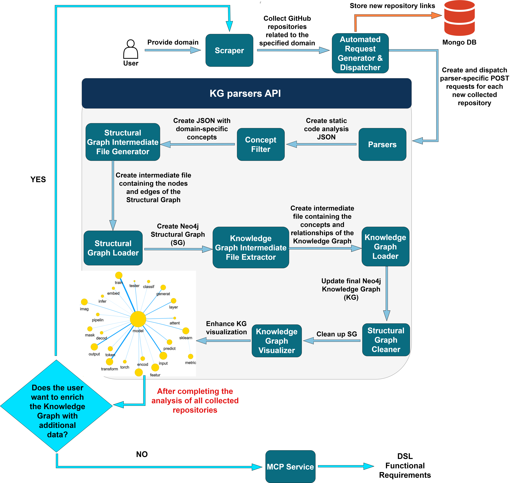
</p>

## Parsers
Parsers take source code as input and extract from it the essential syntactic information, which may incorporate domain knowledge. These pieces of information are then organized and stored in a JSON-formatted file. All parsers produce JSON files of the **same schema**.

## Python Parser
The [Python parser](./parsers/python_parser/python_parser.py) recursively scans each directory of the codebase and identifies all files with the **.py** extension. It then leverages the **LibCST** library to convert the source code of each identified file into a separate **Concrete Syntax Tree (CST)** without any loss of information.

Additionally, a visitor is employed, providing specialized extraction functions for each type of node corresponding to essential syntactic structures. During the traversal of the CSTs, the detection of specific node types triggers the corresponding visitor functions, resulting in the extraction of all relevant information contained within the codebase files.

At the same time, the scope of the extracted syntactic structures is preserved, enabling the identification of both top-level and nested classes and functions in the source code.
## Java Cpp C Parsers
The [Java](./parsers/java_parser/java_parser.py), [C++](./parsers/cpp_parser/cpp_parser.py), and [C](./parsers/c_parser/c_lang_parser.py) parsers are used for the static analysis of codebases written in the Java, C++, and C programming languages, respectively. Their functionality is based on the **srcML** tool, which converts the source code of each file in the codebase into a **detailed XML representation**. The generated XML files have significant similarities across the three languages, as the tags corresponding to the core syntactic structures share the same naming conventions. As a result, the implementation of the three parsers is largely identical. 

Initially, the parsers identify all files in the codebase that contain source code written in Java, C++, and C, respectively, and then invoke the srcML tool to convert them into XML files with the same name. Subsequently, the parsers recursively scan each directory of the XML representation to locate all generated XML files. The **lxml** library is then leveraged to thoroughly **parse each individual XML file** and **produce a separate ElementTree**. Each node of the ElementTree corresponds to a specific XML tag and is referred to as an element. Static analysis of the code is performed on this tree-based representation using a variety of **XPath queries**. These queries are applied to the ElementTree to identify nodes that encapsulate the essential syntactic structures of the source code.
## JavaScript Parser
The [JavaScript parser](./parsers/javascript_parser) detects all files with the **.js** extension within the codebase. It also leverages the **@babel/parser** package to **transform the source code of each identified file into a separate Abstract Syntax Tree (AST)**. During this transformation, a set of plugins from the **Babel ecosystem** is enabled, allowing for the accurate recognition of both the core syntactic structures of JavaScript and more specialized cases. In this way, the successful construction of the AST is ensured even for relatively complex code files. Subsequently, the **@babel/traverse** package is used to systematically **traverse all generated ASTs**. Through this process, all essential information embedded in the source code is extracted.

## Parsers Result
For each individual source code file, the following information is extracted:

1. The file name (**file**).
2. The declared libraries (**imports**).
3. The global variables (**global_variables**).
4. The functions (**functions**), along with:
   - their input parameters (**params**),
   - their local variables (**local_variables**), and
   - any nested functions (**nested_functions**) they may contain.
5. The classes (**classes**), along with:
   - their attributes (**attributes**),
   - their methods (**methods**), which include:
     - their input parameters (**params**),
     - their local variables (**local_variables**), and
     - any nested functions (**nested_functions**) they may contain, and
   - any nested classes (**nested_classes**) they may contain.

Nested syntactic structures are detected only by the Python parser.

```
[
    {
      "file": "test_QuantileRegression.py"
    },
    {
      "imports": [
        "unittest",
        "numpy",
        "sklearn.datasets.make_regression",
        "uq360.algorithms.quantile_regression.QuantileRegression",
        "uq360.metrics.picp",
        "uq360.metrics.mpiw"
      ]
    },
    {
      "global_variables": []
    },
    {
      "functions": []
    },
    {
      "classes": [
        {
          "name": "TestQuantileRegression",
          "attributes": [],
          "methods": [
            {
              "name": "_generate_mock_data",
              "params": [
                "self",
                "n_samples",
                "n_features"
              ],
              "local_variables": [],
              "nested_functions": []
            },
            {
              "name": "test_fit_predict_and_metrics",
              "params": [
                "self"
              ],
              "local_variables": [
                "y",
                "X",
                "config",
                "uq_model",
                "yhat_lb",
                "yhat",
                "yhat_ub",
                "coverage",
                "avg_width"
              ],
              "nested_functions": []
            }
          ]
        }
      ]
    }
  ]
```

## Concept Filter
The [Concept Filter](./concept_filter/stopwords_filter.py) is responsible for **isolating domain-specific terms** related to the domain of the codebase. This subsystem takes as **input the JSON file produced by the parsers** and **removes all general and common terms (stopwords and common code words)**. To achieve this, it applies various **tokenization and filtering mechanisms** to the words and phrases contained in the parsers output. In this way, it **produces a new JSON file of the same schema**, which contains only the concepts relevant to the domain of the codebase.

Initially, the concept filter applies various **tokenization techniques** in order to **split all compound words into individual tokens that cannot be further decomposed**. More specifically :
1. Separation of characters and numbers that coexist in the same name : “variable1Data” ----> “variable 1 Data”.
2. Replacement of all **special characters** with whitespaces : “foo_bar − baz.qux” ---> “foo bar baz qux”.
3. Splitting of compound words that follow the **CamelCase** convention : “parseJsonData” ---> “parse Json Data”.
4. Splitting of compound words that follow the **PascalCase** convention : “XmlHttpRequest” ---> “Xml Http Request”.
5. Conversion of all individual tokens to **lowercase**.

Subsequently, **all extracted tokens are filtered** in order to **retain only those related to the domain of the codebase**. To achieve this, **4 JSON files are utilized**, each containing a **different collection of stopwords and common code words**. These JSON files are located in the [concept_filter directory](./concept_filter), and the sources used to construct them are references [1](https://github.com/stopwords-iso/stopwords-iso), [2](https://github.com/e3b0c442/keywords), [3](https://github.com/abbrcode/abbreviations-in-code), [4](https://github.com/Alir3z4/stop-words/), and [5](https://github.com/glukhman/Learning-English-Past-Tense-RNN/). Additionally, ChatGPT was used to provide **common infrastructure concepts** that appear in many codebases regardless of domain.

**All terms contained in these JSON files are converted to lowercase and then merged into a single unified set. The removal of all tokens that appear in this set constitutes the primary filtering method**. Furthermore, additional filtering techniques are applied, such as removing all tokens with a length of less than three characters.

## Concept Filter Result
```
[
    {
      "file": "quantile regression"
    },
    {
      "imports": [
        "unittest",
        "numpy",
        "sklearn datasets regression",
        "algorithms quantile regression quantile regression",
        "metrics picp",
        "metrics mpiw"
      ]
    },
    {
      "global_variables": []
    },
    {
      "functions": []
    },
    {
      "classes": [
        {
          "name": "quantile regression",
          "attributes": [],
          "methods": [
            {
              "name": "generate",
              "params": [
                "",
                "samples",
                "features"
              ],
              "local_variables": [],
              "nested_functions": []
            },
            {
              "name": "fit predict metrics",
              "params": [
                ""
              ],
              "local_variables": [
                "",
                "",
                "",
                "model",
                "yhat",
                "yhat",
                "yhat",
                "coverage",
                ""
              ],
              "nested_functions": []
            }
          ]
        }
      ]
    }
  ]
```
## Temporary Structural Graph
The [Structural Graph (SG)](./structural_graph) represents, in graph form, the contents of the JSON file produced by the concept filter. In other words, it **models the “cleaned” syntactic structures of the code, as well as the programming relationships that connect them, through nodes and edges**. The SG serves as an **intermediate stage through which the final Knowledge Graph (KG) is updated**. Consequently, it may contain nodes and edges that correspond exclusively to a single code repository. Furthermore, the content of the **SG is appropriately transformed to become compatible with the representation schema of the KG** and is then integrated into it, thus achieving its update. After the update process is completed, the SG is deleted and reinitialized for the analysis of the next repository. For this reason, it is characterized as **temporary**.

For the construction of the SG, an [intermediate file](./structural_graph/json_creation_for_neo4j.py) is first created, containing all the output information of the concept filter in the form of nodes and edges. Then, the data from this file are [loaded into the Neo4j software](./structural_graph/loader_script.py), thereby enabling the construction of the temporary SG.

(⚠️ **Note**: In the comments, the structural graph is often referred to as “structured”. This reflects an earlier naming convention and will be updated in future versions for consistency and clarity.)

## SG Intermediate File
The intermediate file **maps each category of syntactic structure to a specific node type**. Additionally, it **maps each type of programming relationship between two syntactic structures to a specific edge type**.

- **NODE TYPES**
  - FILE
  - IMPORT
  - GLOBAL_VAR
  - CLASS
  - NESTED_CLASS
  - FUNCTION
  - NESTED_FUNCTION
  - METHOD
  - PARAM
  - LOCAL_VAR
  - ATTRIBUTE
  - REPO (purely technical and not relevant to the domain)

- **EDGE TYPES**
  - FILE -[**EXISTS_IN**]-> REPO (connects all files in the repository)
  - FILE -[**FILE_CONTAINS**]-> CLASS/FUNCTION
  - FILE -[**IMPORTS**]-> IMPORT
  - FILE -[**HAS_GLOBAL_VAR**]-> GLOBAL_VAR
  - CLASS -[**HAS_ATTRIBUTE**]-> ATTRIBUTE
  - CLASS -[**HAS_METHOD**]-> METHOD
  - FUNCTION/METHOD -[**HAS_PARAM**]-> PARAM
  - FUNCTION/METHOD -[**HAS_LOCAL_VAR**]-> LOCAL_VAR
  - FUNCTION/METHOD -[**HAS_NESTED_FUNCTION**]-> NESTED_FUNCTION
  - CLASS -[**HAS_NESTED_CLASS**]-> NESTED_CLASS

At this point, it should be emphasized that **all nodes and edges** of the intermediate file are associated with an **appropriate weight (greater than 0 and less than 1), which reflects both their importance in the context of static analysis and their usefulness for the extraction of domain-specific languages**. In this way, **greater emphasis** is given to the nodes and edges that represent the **most central syntactic structures and programming relationships of the source code**.

- **NODE WEIGHTS** 
  - 0,95 for CLASS nodes
  - 0,9 for FUNCTION nodes
  - 0,85 for METHOD nodes
  - 0,65 for ATTRIBUTE nodes
  - 0,65 for GLOBAL_VAR nodes
  - 0,6 for IMPORT nodes
  - 0,5 for FILE nodes
  - 0,45 for NESTED_CLASS and NESTED_FUNCTION nodes
  - 0,4 for PARAM nodes
  - 0,2 for LOCAL_VAR nodes
  - 0,05 for REPO nodes

**The weights of CLASS, FUNCTION, and METHOD nodes take the highest values**, as the syntactic structures they represent constitute the **core “skeleton” of any program** and are particularly important from the perspective of static analysis. Moreover, **they form the foundation of domain-specific languages (DSLs)**, since **nodes of type CLASS represent entities**, while **nodes of type FUNCTION and METHOD express actions and behaviors, respectively**. Therefore, they serve as the basis for constructing the backbone of a DSL.

The remaining node types are assigned weights according to the importance of the structures they represent. It should also be noted that nodes of type NESTED_CLASS and NESTED_FUNCTION are assigned a weight of **0.45 when they appear at the first level of nesting**, that is, when they are defined within top-level classes or functions. **In cases of deeper nesting**, where the parent node is also nested, a **decay factor** is applied, resulting in an exponential decrease in their weight. Additionally, the REPO node is assigned a very small weight, as it does not contain any substantial information.

Finally, it should be emphasized that **this particular choice of weights is not the only possible solution**, as alternative weight values may perform equally well. However, **the current configuration was experimentally evaluated on a large number of repositories and, in practice, was shown to yield highly satisfactory results**.

---
- **EDGE WEIGHTS**

The weights of edges are calculated as the **average of the weights of the two nodes they connect**. This choice of arithmetic operation ensures that the weight of the edge equally reflects the importance of both nodes at its endpoints.

  The most important edges are the following:
  - CLASS -[**HAS_METHOD**]-> METHOD (**weight = 0,9**)
  - CLASS -[**HAS_ATTRIBUTE**]-> ATTRIBUTE (**weight = 0,8**)
  - FILE -[**FILE_CONTAINS**]-> CLASS (**weight = 0,725**)
  - FILE -[**FILE_CONTAINS**]-> FUNCTION (**weight = 0,7**)
---

- **NODE DEPTH**

**Each node in the intermediate file is associated with a depth value**, which reflects the level of nesting of the syntactic structure it represents. Consequently, only nodes of type **NESTED_CLASS and NESTED_FUNCTION have a non-zero depth value**.

---

- **NODE STRUCTURE**
```
{
      "type": "CLASS",
      "name": "quantile regression",
      "weight": 0.95,
      "depth": 0
 }
```
---
- **EDGE STRUCTURE**
```
{
      "type": "HAS_METHOD",
      "from": "quantile regression",
      "to": "fit predict metrics",
      "from_type": "CLASS",
      "to_type": "METHOD",
      "from_weight": 0.95,
      "to_weight": 0.85,
      "final_weight": 0.9
 }
```
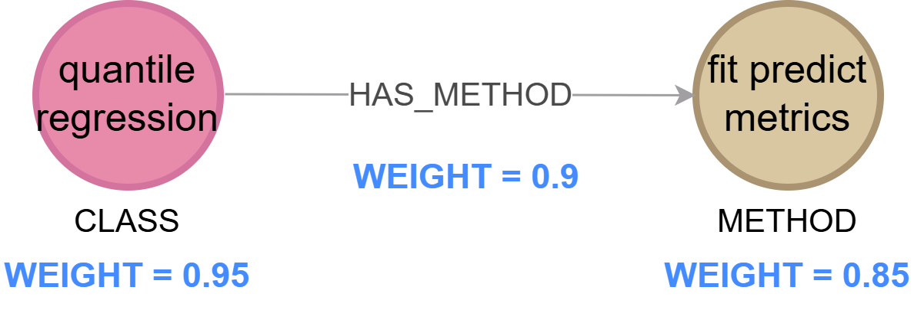

---
## SG Intermediate File Result
```
{ "nodes": [
    {
      "type": "REPO",
      "name": "REPO_ANON_GLOBAL_1",
      "weight": 0.05,
      "depth": 0
    },
    {
      "type": "FILE",
      "name": "quantile regression",
      "weight": 0.5,
      "depth": 0
    },
    {
      "type": "IMPORT",
      "name": "unittest",
      "weight": 0.6,
      "depth": 0
    },
    {
      "type": "IMPORT",
      "name": "numpy",
      "weight": 0.6,
      "depth": 0
    },
    {
      "type": "IMPORT",
      "name": "sklearn datasets regression",
      "weight": 0.6,
      "depth": 0
    },
    {
      "type": "IMPORT",
      "name": "algorithms quantile regression quantile regression",
      "weight": 0.6,
      "depth": 0
    },
    ...
  ],
  "edges": [
    {
      "type": "EXISTS_IN",
      "from": "quantile regression",
      "to": "REPO_ANON_GLOBAL_1",
      "from_type": "FILE",
      "to_type": "REPO",
      "from_weight": 0.5,
      "to_weight": 0.05,
      "final_weight": 0.275
    },
    {
      "type": "IMPORTS",
      "from": "quantile regression",
      "to": "unittest",
      "from_type": "FILE",
      "to_type": "IMPORT",
      "from_weight": 0.5,
      "to_weight": 0.6,
      "final_weight": 0.55
    },
    {
      "type": "IMPORTS",
      "from": "quantile regression",
      "to": "numpy",
      "from_type": "FILE",
      "to_type": "IMPORT",
      "from_weight": 0.5,
      "to_weight": 0.6,
      "final_weight": 0.55
    },
    {
      "type": "IMPORTS",
      "from": "quantile regression",
      "to": "sklearn datasets regression",
      "from_type": "FILE",
      "to_type": "IMPORT",
      "from_weight": 0.5,
      "to_weight": 0.6,
      "final_weight": 0.55
    },
    {
      "type": "IMPORTS",
      "from": "quantile regression",
      "to": "algorithms quantile regression quantile regression",
      "from_type": "FILE",
      "to_type": "IMPORT",
      "from_weight": 0.5,
      "to_weight": 0.6,
      "final_weight": 0.55
    },
    ...
  ] 
}
```
---
## SG Loader
The **construction of the SG** is achieved by loading the nodes and edges of the intermediate file into the **Neo4j Desktop software**. Specifically, the **Neo4j Python driver establishes the communication channel between the system and the DBMS that hosts the SG**. Furthermore, data loading is performed by issuing appropriate **Cypher queries based on the MERGE command**, which creates new nodes and edges only if they do not already exist in the graph. Consequently, this command helps **eliminate duplicate data contained in the intermediate file** while ensuring the uniqueness of the nodes and edges inserted into the SG.

---
## SG Visualization
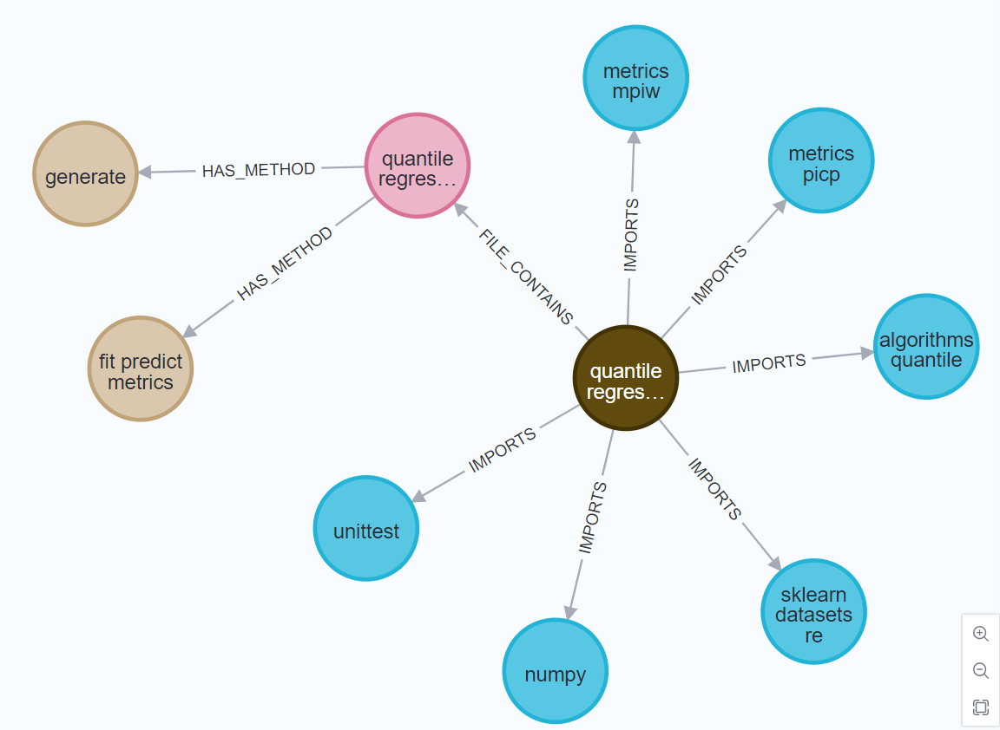

---
## Final Semantic Knowledge Graph
The [Knowledge Graph (KG)](./knowledge_graph) is derived from the SG and contains **clean knowledge about the domains** of the analyzed code repositories. More specifically, the **SG cannot be considered a knowledge graph**, as it has been observed that it often **contains multiple representations of the same information**. This occurs because **the same conceptual content is expressed through different syntactic structures of static analysis**, which in the context of the SG are modeled as different types of nodes and edges.

Indicatively, the **SG may include edges such as** :

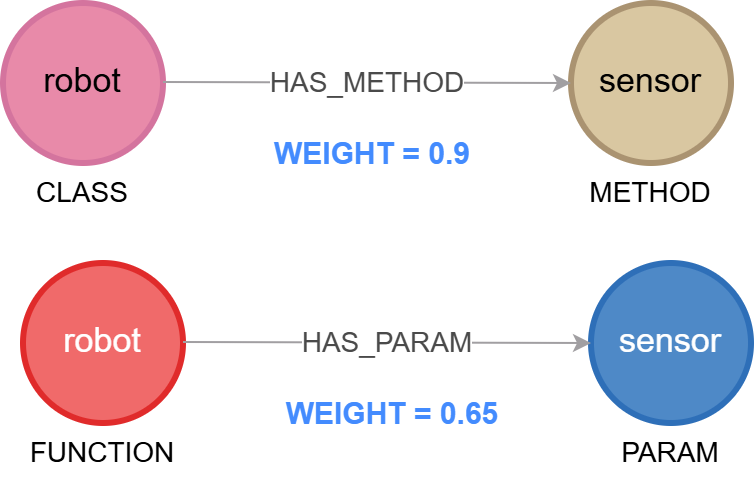

Although the above edges differ in terms of node types and their syntactic interpretation, they **essentially express the same knowledge**, namely that the **concept robot is related to the concept sensor**. Therefore, in the KG, the goal is to unify such equivalent associations into a single relationship between the corresponding concepts. In the above example, **the clean knowledge is represented as a single relationship robot → sensor, whose weight is derived from the sum of the weights of all individual SG edges that it incorporates**.

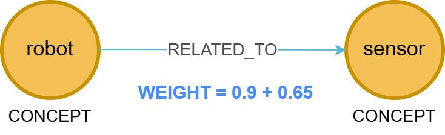

Thus, within the context of this thesis, **clean knowledge is defined as the existence of unique pairs of concepts that are free from the details of the static analysis of the source code**.

For updating the KG, an [intermediate file](./knowledge_graph/knowledge_graph_define_json.py) is first created, in which the entire set of transformed information derived from the SG is recorded. Then, the nodes and relationships from this file are [loaded into the Neo4j software](./knowledge_graph/update_knowledge_graph.py), and in this way, the final KG is updated.

## KG Intermediate File
For its creation, a **connection to the SG is established via the Neo4j driver**, and subsequently, the appropriate Cypher queries are executed in order to retrieve the necessary information from the nodes and edges of the SG. Then, a **series of transformations is applied to all the retrieved nodes and edges**, which are presented in detail below.

**1. Node and Relationship Types**

All nodes are assigned the same type, **CONCEPT**, while all relationships are assigned the same type, **RELATED_TO**. The name CONCEPT was chosen because **each node in the KG corresponds to a specific domain concept**, whereas the name RELATED_TO was chosen because **each relationship in the KG represents an association between two domain concepts**.

**2. SG Node Name Processing**

**The name of each node in the KG must strictly correspond to a single word (token) that expresses a specific concept**. However, in the SG there are nodes whose names consist of two or more tokens. For this reason, the node names in the SG are initially **split** into their individual unique tokens. Subsequently, **stemming** is applied to each token, so that **different linguistic forms of the same concept are transformed into a common representation**. In this way, it becomes possible to merge KG nodes that refer to the same concept.

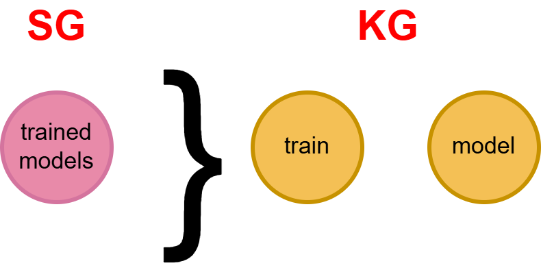


**3. Creation of Undirected Relationships**

**Alphabetical normalization is applied to the endpoints of each relationship** in the KG in order to avoid the creation of duplicate relationships that represent the same pair of concepts. As a result, **every relationship contained in the KG is undirected**.

**4. Creation of Co-existence Relationships**

**Co-existence relationships are created between concepts that appear together in the name of an SG node**. More specifically, when an SG node contains more than one token in its name, these tokens are mapped to separate nodes in the KG and are connected to each other through relationships of type RELATED_TO. The weights of these relationships are equal to the weight of the original node in the SG. Additionally, **if the same pair of concepts appears more than once, the weight of the relationship is updated cumulatively**.


**5. Cartesian Product**

For each edge in the SG, the names of the two nodes at its endpoints are transformed into two sets of tokens through the splitting and stemming process described earlier. Then, the **Cartesian product** operation is applied, resulting in the **creation of RELATED_TO relationships for all possible combinations of tokens from the two sets**. Furthermore, **each generated relationship is assigned a weight equal to that of the corresponding SG edge, while in cases where the same pair of concepts appears multiple times, the weight is updated cumulatively**.

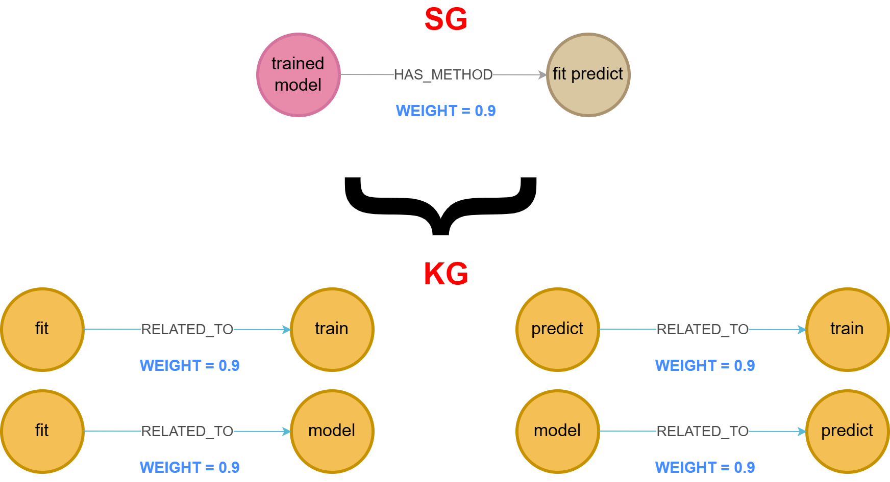

---
**Important Remarks**

For each unique node in the KG, **the number of its occurrences (count)** is recorded at the repository level, since the SG contains information from a single repository at a time. Similarly, for each unique relationship, its number of occurrences (count) is recorded at the repository level. At this point, it should be noted that **the greater the weight (final_weight) of a relationship in the KG, the stronger the pair of domain concepts it represents is considered to be.**

**Furthermore, the most dominant nodes are those with the highest counts, while the most dominant relationships are those with the greatest weights.**

---
- **NODE STRUCTURE**
```
{
      "type": "CONCEPT",
      "name": "quantil",
      "count": 8
}
```

- **RELATIONSHIP STRUCTURE**
```
{
      "type": "RELATED_TO",
      "from": "quantil",
      "to": "regress",
      "final_weight": 6.85,
      "count": 11
}
```
---
## KG Intermediate File Result
```
{
  "nodes": [
    {
      "type": "CONCEPT",
      "name": "quantil",
      "count": 8
    },
    {
      "type": "CONCEPT",
      "name": "regress",
      "count": 67
    },
    {
      "type": "CONCEPT",
      "name": "unittest",
      "count": 1
    },
    {
      "type": "CONCEPT",
      "name": "numpi",
      "count": 4
    },
    {
      "type": "CONCEPT",
      "name": "sklearn",
      "count": 41
    },
    {
      "type": "CONCEPT",
      "name": "dataset",
      "count": 12
    },
    {
      "type": "CONCEPT",
      "name": "algorithm",
      "count": 22
    },
    {
      "type": "CONCEPT",
      "name": "metric",
      "count": 49
    },
    {
      "type": "CONCEPT",
      "name": "picp",
      "count": 8
    },
    {
      "type": "CONCEPT",
      "name": "mpiw",
      "count": 4
    },
    ...
  ],
  "relationships": [
    {
      "type": "RELATED_TO",
      "from": "quantil",
      "to": "regress",
      "final_weight": 6.85,
      "count": 11
    },
    {
      "type": "RELATED_TO",
      "from": "quantil",
      "to": "unittest",
      "final_weight": 0.55,
      "count": 1
    },
    {
      "type": "RELATED_TO",
      "from": "regress",
      "to": "unittest",
      "final_weight": 3.3,
      "count": 6
    },
    {
      "type": "RELATED_TO",
      "from": "numpi",
      "to": "quantil",
      "final_weight": 0.55,
      "count": 1
    },
    {
      "type": "RELATED_TO",
      "from": "numpi",
      "to": "regress",
      "final_weight": 7.15,
      "count": 13
    },
    {
      "type": "RELATED_TO",
      "from": "quantil",
      "to": "sklearn",
      "final_weight": 1.1,
      "count": 2
    },
    {
      "type": "RELATED_TO",
      "from": "regress",
      "to": "sklearn",
      "final_weight": 10.65,
      "count": 19
    },
    ...
  ]
}  
```
---
## KG Loader
The **update of the Knowledge Graph** is achieved by loading the nodes and relationships from the intermediate file into the Neo4j Desktop software. More specifically, the **Neo4j Python driver establishes the communication channel between the system and the DBMS that hosts the KG**. The data loading process is performed through the **execution of appropriate Cypher queries based on the MERGE command**. In this way, the uniqueness of the nodes and relationships inserted into the KG is ensured. 

At the same time, whenever a node or a relationship is encountered again across different repositories, the corresponding properties **count and final_weight are updated cumulatively**. Therefore, the **count now represents the total number of occurrences of a node or relationship across all repositories analyzed so far, while the final_weight reflects the overall contribution of all occurrences of the same relationship**.

After updating the Knowledge Graph, the temporary Structural Graph is [deleted](./structural_graph/delete_temporary_structural_graph.py).

---
## KG Default Visualization
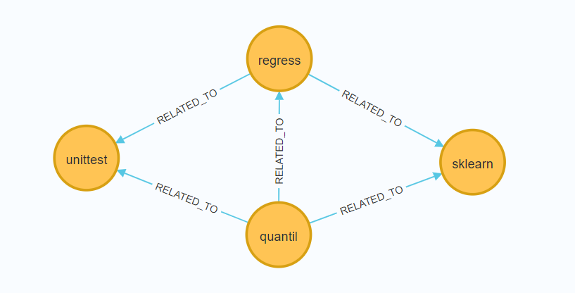
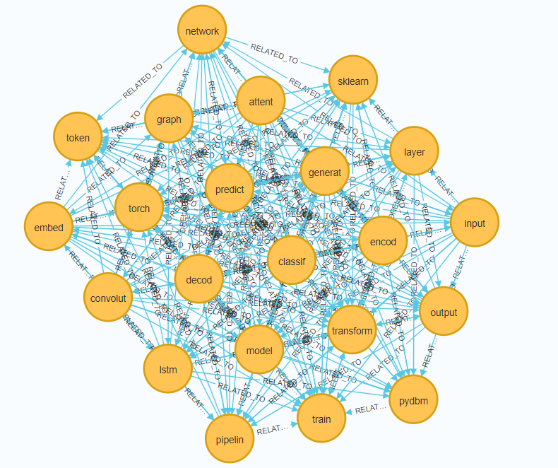

---
## Knowledge Graph Visualizer
The visualization generated by the Neo4j software fails to visually highlight the importance of the nodes and relationships contained in the KG. As a result, all nodes are displayed with the same size and all relationships are rendered with the same thickness, **regardless of the values of their respective count and final_weight properties**.

To address this limitation, the [Knowledge Graph Visualizer (KG Visualizer)](./live_update_kg/graph_better_visualization.py) produces an **enhanced visualization of the Knowledge Graph during the update process**. Specifically, the **most significant nodes are displayed with larger sizes, while the strongest relationships are represented with greater thickness**.

## Better Visualization Examples
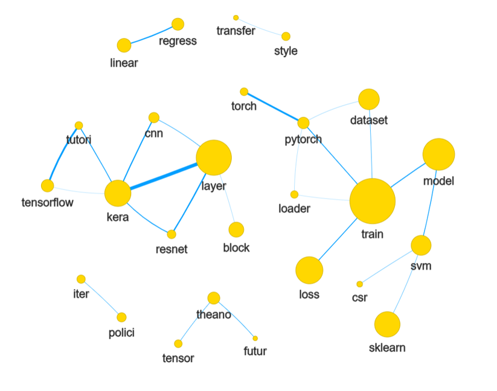
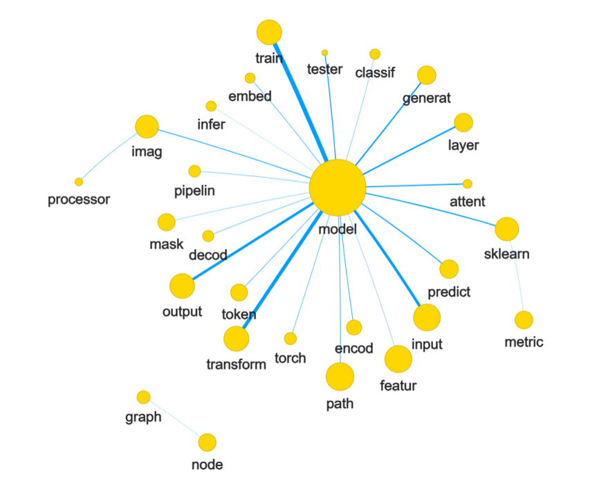

**Minimal Example for Full Pipeline** [HERE](./readme-images/full_run_for_repo_white.png)

---
## KG parsers API
Within the context of this thesis, the [KG Parsers API](./api.py) is developed, which **functions as a unified interface for the subsystems presented in the previous sections**. More specifically, the **API automates the process of extracting and organizing domain knowledge for a given repository** by sequentially performing the following actions:

**1.** Downloads the repository zipball via the GitHub REST API.

**2.** Extracts the repository and stores it in a temporary local directory to enable further processing.

**3.** Selects the appropriate parser and performs static analysis on the repository.

**4.** Isolates domain-specific terms from the results of the static analysis.

**5.** Generates the intermediate SG file, which contains the nodes and edges to be stored in the SG.

**6.** Constructs the SG.

**7.** Appropriately transforms the SG data. In this way, generates the intermediate KG file, which contains the concepts and relationships to be inserted into the KG.

**8.** Updates the KG.

**9.** Deletes the contents of the SG.

**10.** Produces an improved visualization of the most dominant concepts and relationships in the KG.

**11.** Finally, deletes the temporary local directory containing the repository’s source code.

---
## Scraper
The [Scraper](./github_repos_scraper.py) connects to the **GitHub Search API** and **collects the URLs of repositories related to a specific domain**. 

(⚠️ **Note:** The name Scraper should be revised, as it does not strictly behave as a traditional scraper. This will be addressed in a future update.)

The scraper initially prompts the user, through the console, to **specify the domain of the repositories to be collected**. It then generates three query variants based on the user-provided domain, which are submitted to the GitHub Search API. At this point, it is important to note that **the use of query variants is necessary, as the GitHub Search API returns up to 1000 repositories per query**. Therefore, in order to retrieve a larger number of repositories, **multiple queries focusing on the same domain** must be issued.

For each individual query, the collection of repositories is performed in cycles (**scraping cycles**). In each cycle, the scraper retrieves results incrementally in pages, with each page containing up to 100 repositories. Additionally, each cycle is completed either when a total of 500 repositories have been collected or when the GitHub Search API returns no further results for the given query.

After the completion of each cycle, the **scraper stores the collected URLs in a JSON file and subsequently initiates the [Automated Request Generator and Dispatcher](#Automated-Request-Generator-and-Dispatcher) to perform the automated analysis of the repositories**. The collection of new URLs resumes only after the analysis of all repositories in the current cycle has been completed. Finally, after the execution of all queries, the scraper enters a waiting state (**sleep mode**) for a predefined period of time and then **repeats the same collection process**.

- **Example Result for Scraper :**
```
[
 "https://github.com/emnikhil/Sign-Language-To-Text-Conversion",
 "https://github.com/HKUSTMDI/SmartWSI-SAM",
 "https://github.com/neptune-ai/neptune-client",
 ...
]
```

---
## Automated Request Generator and Dispatcher
The [Automated Request Generator and Dispatcher](./automate_post_requests.py) **automates the bulk submission of requests to the [KG parsers API](#KG-parsers-API)**. Specifically, it receives the JSON file generated during each scraping cycle and **cross-references its contents with a MongoDB database, where the URLs of repositories that have already been analyzed by the system are stored**. As a result, URLs that are found in the database are discarded, while only new URLs are retained. These new URLs are then inserted into MongoDB so that they are considered already analyzed in future executions.

Additionally, it **generates a new JSON file that contains, for each new repository, 5 API requests (1 request for each parser)**. As a result, manual specification of the programming language of the repositories is no longer required. **The requests in this JSON file are then sent sequentially to the API**, while in cases where a parser is not compatible with the repository’s programming language, it simply produces an empty result. **In this way, the automated analysis of all repositories collected by the scraper is achieved**.

- **Example POST request to the KG Parser API**
 ```
      {
        "choice": "1",
        "repo_url": "https://github.com/robotics-4-all/intelligent_robot_systems"
      }
 ```
  - choice : indicates specific parser
    - 1 for C++ parser
    - 2 for C parser
    - 3 for Python Parser
    - 4 for Java Parser
    - 5 for JavaScript Parser
  - repo_url : The repositoty URL

- **Example Result for Automated Request Generator and Dispatcher**
```
[
  {
    "choice": "1",
    "repo_url": "https://github.com/emnikhil/Sign-Language-To-Text-Conversion"
  },
  {
    "choice": "2",
    "repo_url": "https://github.com/emnikhil/Sign-Language-To-Text-Conversion"
  },
  {
    "choice": "3",
    "repo_url": "https://github.com/emnikhil/Sign-Language-To-Text-Conversion"
  },
  {
    "choice": "4",
    "repo_url": "https://github.com/emnikhil/Sign-Language-To-Text-Conversion"
  },
  {
    "choice": "5",
    "repo_url": "https://github.com/emnikhil/Sign-Language-To-Text-Conversion"
  },
  ...
]
```

---
## MCP Service
The [MCP Service (Model Context Protocol Service)](./mcp) is used to **leverage the knowledge stored in the Knowledge Graph (KG) for the purpose of generating Functional Requirements (FRs) for various Domain Specific Languages (DSLs)**. More specifically, the MCP service consists of a server and a client. The [server](#Server) contains tools that execute appropriate Cypher queries on the KG and retrieve specific knowledge. The [client](#Client) is responsible for establishing the connection between the server and the **Claude Sonnet 4 LLM**, enabling the language model to access the server’s tools and, in this way, utilize the knowledge of the KG for the generation of FRs.

## Server
The [server](./mcp/mcp_server.py) exposes 3 tools. Each tool connects to the KG via the Neo4j driver and subsequently executes an appropriate Cypher query in order to retrieve specific knowledge.

>1. neo4j_top_concepts tool

**Retrieves the most frequently occurring concepts contained in the Knowledge Graph**. Specifically, it identifies the nodes with the highest values of the count property and returns them sorted in descending order based on this value.

>2. neo4j_top_related_concepts tool

**Retrieves the most dominant pairs of concepts (relationships) contained in the Knowledge Graph**. In particular, it identifies the relationships with the highest values of the final_weight property and returns them sorted in descending order based on this value.

At this point, it should be noted that the **neo4j_top_concepts and neo4j_top_related_concepts tools are useful for extracting meaningful insights regarding the most prevalent domains within the Knowledge Graph**. Therefore, when the goal is to develop a DSL for a dominant domain of the KG, these tools constitute the most appropriate choice.

>3. neo4j_neighbors_for_domain tool

**Performs a multi-level neighbor search for a given concept**. At the same time, **it can be used to extract meaningful information about any domain contained in the Knowledge Graph**. In cases where the domain has a composite name, this tool can be executed sequentially for each individual concept that composes it. At the first level of the search, only the direct neighboring nodes of the examined concept are retrieved. At each subsequent level, every neighboring node identified in the immediately preceding level is treated as a new starting concept, in order to retrieve its corresponding direct neighbors. **Finally, the relationships of the KG that form the multi-level neighborhood of the initial concept are returned, sorted in descending order based on their weight**.

---

## Ariadne API
The communication between the client and the Claude Sonnet 4 LLM is achieved through the **Ariadne API**, which has been developed by the [ISSEL (Intelligent Systems and Software Engineering Labgroup)](https://issel.ee.auth.gr/) and operates as a gateway. Specifically, the **Ariadne API provides two main endpoints** for the interaction between the client and the language model, namely:

- **POST /api/v1/chat**
- **POST /api/v1/messages**

The **POST /api/v1/chat endpoint** is used for a basic **single-turn interaction**, during which the client sends a single message to the language model and then receives the model’s complete response. In contrast, the **POST /api/v1/messages endpoint** is used for **multi-turn interaction**, allowing the client to send the entire conversation history through multiple sequential messages and subsequently receive the final response from the model.

## Client
Initially, the [client](./mcp/test.py) launches the server as a separate process (subprocess), using the [stdio_client transport mechanism](https://github.com/modelcontextprotocol/python-sdk/blob/main/src/mcp/client/stdio.py). Subsequently, the client retrieves the list of all available tools provided by the server. **For each tool, its name, description, and input parameters are obtained**. 

The client then communicates with the Claude LLM through the Ariadne API. More specifically, it uses the **POST /api/v1/chat endpoint** to send the user message (user prompt), along with the list of available server tools, to the Claude LLM. At this point, it should be noted that the user prompt contains sufficiently explicit instructions to the language model regarding the generation of Functional Requirements (FRs) for a specific DSL. If the response returned by the language model does not include any tool use requests, the process of generating functional requirements is terminated.

Otherwise, the client executes each requested tool through the server, providing the corresponding input parameters defined by the language model. Then, it uses the **POST /api/v1/messages endpoint** to send the execution results (tool results) back to Claude. The use of this endpoint is necessary, as continuing the interaction with the language model requires sending the full conversation history rather than a single message. For this purpose, the client constructs the conversation history, which includes the user prompt, the tool use requests, and the corresponding tool results. In this way, Claude gains access to structured domain knowledge and produces the final response, which consists of sufficiently specialized functional requirements for a given DSL. Finally, the client displays Claude’s response in the terminal.

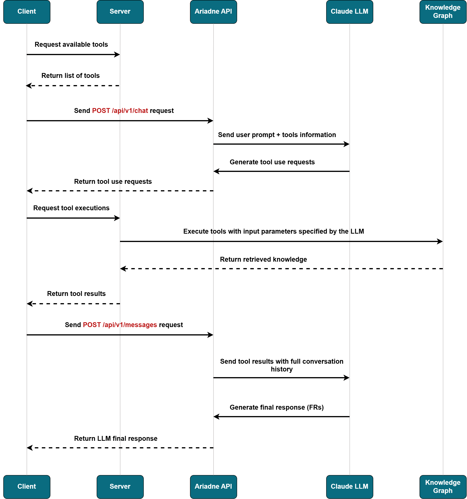

---
## Full System Execution

- **Prerequisites**
1. pip install -r requirements.txt
2. npm install @babel/parser@7.28.4 @babel/traverse@7.28.4 @babel/types@7.28.4
3. **srcML** must be installed, otherwise the parsers (C, C++, Java) that depend on it will NOT run.
4. The api.py file must be located in the same folder as the .venv that will be created.
5. Launch the DBMS that hosts the structural graph and the knowledge graph in Neo4j Desktop
6. Neo4j Desktop version used : 1.6.3 (Version 2 can likely be used without any modifications)
7. Neo4j DBMS version used : 5.26.5

- **Execution**
1. Open a new terminal and start the api.py by running: ```uvicorn api:app```
2. Then, run the github_repos_scraper.py file.
3. When prompted, enter a domain of your choice in the console (and press ENTER).
4. After that… just watch 😎
---
## Experimental Validation
A static analysis was conducted on **1,300 code repositories belonging to the broader field of Machine Learning**. Subsequently, the **MCP Service** was utilized to connect the Knowledge Graph with the Claude Sonnet 4 LLM. In this way, the Knowledge Graph provides Claude with structured domain knowledge and helps it generate functional requirements (FRs) for DSLs within the field of Machine Learning.

Within this context, FRs are generated for each of the following 3 DSLs:
1. **Deep Learning** DSL
2. **Machine Learning over Data Streams** DSL
3. **Natural Language Processing pipelines and Machine Learning** DSL

At the same time, an equal number of FRs are generated for the same DSLs using **Claude Sonnet 4 as a standalone LLM, without its connection to the Knowledge Graph**. This enables a comparison between the results produced through our approach and those produced by the standalone Claude LLM.

## Experiment
The same experiment was applied to each of the 3 DSLs. Specifically, the experiment consists of the following steps:

**1.** For each DSL, 15 FRs are generated using 2 prompt styles, which are the following:

- **Simple Prompt**: Provides basic information to the LLM for generating the FRs.
- **Enhanced Prompt**: An enriched version of the Simple Prompt, which provides the LLM with more detailed instructions regarding the content that the FRs should include.

The use of these 2 prompt styles aims to examine whether our approach outperforms the standalone LLM **regardless of the level of guidance provided through the prompt**. 

The Simple Prompt includes general instructions and does not specify the concepts or individual aspects of the domain that should be covered. Therefore, it simulates a scenario in which a DSL engineer attempts to formulate FRs **without the assistance of a domain expert**.

In contrast, the Enhanced Prompt contains multiple explicit instructions regarding the content of the FRs, which presupposes the availability of domain expertise during the prompt design process. In this way, the **presence of a domain expert** is simulated.

**2.** Each prompt style is applied to both approaches. Therefore, 4 different types of results are produced for each DSL:

- **Simple MCP**: The set of 15 FRs produced by our approach using the Simple Prompt.
- **Simple LLM**: The set of 15 FRs produced by the standalone LLM using the Simple Prompt.
- **Enhanced MCP**: The set of 15 FRs produced by our approach using the Enhanced Prompt.
- **Enhanced LLM**: The set of 15 FRs produced by the standalone LLM using the Enhanced Prompt.

Thus, a total of **60 FRs** are generated for each DSL.
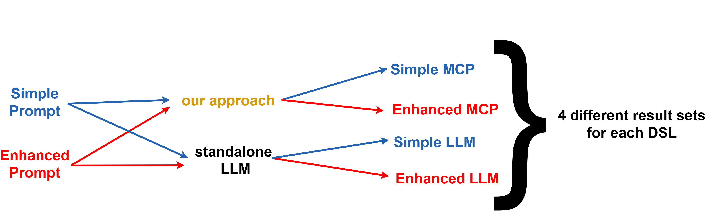

**3.** The FRs generated during the experiment are organized into electronic questionnaires using the Google Forms platform and are subsequently evaluated by **DSL experts** and **Domain experts**.

Specifically, the evaluation criteria are as follows:

- **DSL experts** are asked to rate the FRs on a scale from 1 to 5 based on **how helpful they are for a DSL engineer in developing a DSL for the respective domain**.
- **Domain experts** are asked to rate the FRs on a scale from 1 to 5 based on **how well they describe the correct domain concepts present in the respective field**.

At this point, it should be noted that the process described in this step of the experiment is referred to as **[subjective evaluation](#Subjective-Evaluation)** of the methodology.
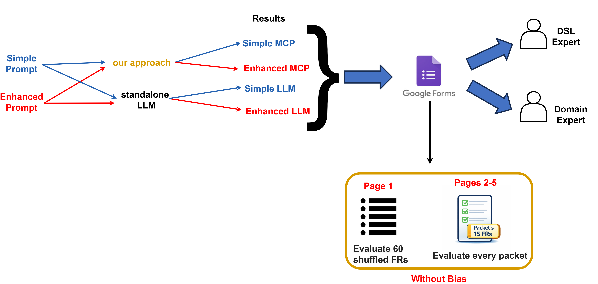

**4.** Finally, the **number of domain concepts** contained in the Enhanced MCP and Enhanced LLM result sets is counted for each DSL. In this way, it becomes possible to compare the two approaches in terms of the number of domain concepts they include. This process is referred to as **[objective evaluation](#Objective-Evaluation)** of the methodology.
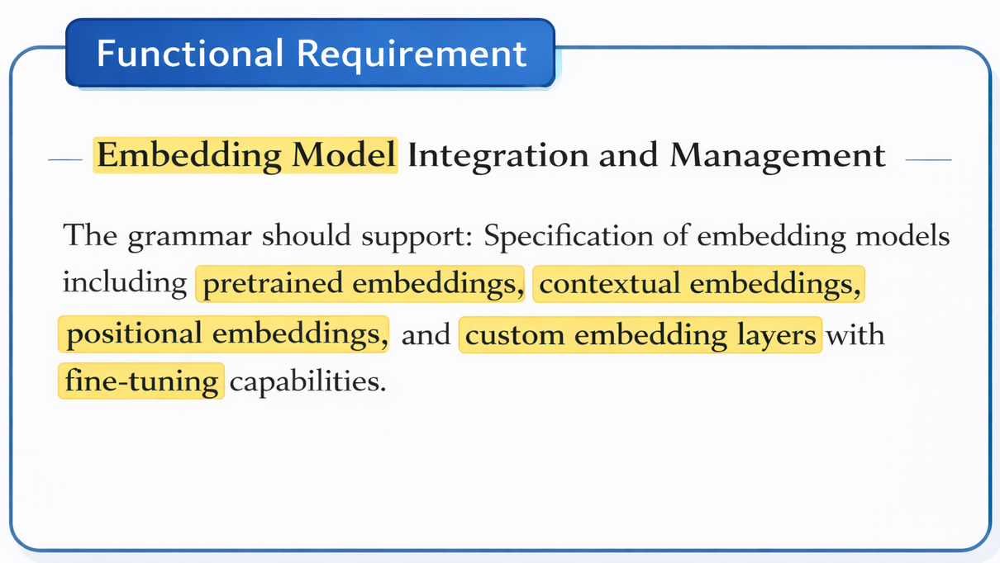

## Subjective Evaluation
For each DSL, a separate questionnaire ([1](https://docs.google.com/forms/d/e/1FAIpQLSeA8vLZ0o62tojkjaXanZEv8SYQ5YHFVhuX9QSFQpjh0pA8ug/viewform), [2](https://docs.google.com/forms/d/e/1FAIpQLSeec7GQewrW1o5auCPszeE1At0A7Rb3maM3hYugYFf_uK7GOA/viewform), [3](https://docs.google.com/forms/d/e/1FAIpQLSd2j-mP15Mc3t-vVHJpnGIQ26Bbm1S2tQH1FBc4Fz3tMChp5A/viewform)) was created, containing exclusively the FRs generated for that specific DSL.

In addition, all questionnaires follow the structure below:
- On the first page, evaluators **rate each individual FR** from all result sets on a scale from 1 to 5.
- On each subsequent page, evaluators **rate each result set as a whole** on a scale from 1 to 5.

Furthermore, the approach and prompt style used to generate the FRs are not disclosed, ensuring an **unbiased evaluation**.

The Deep Learning DSL was evaluated by 6 evaluators (4 DSL experts + 2 Domain experts), while each of the other DSLs was evaluated by 5 evaluators (4 DSL experts + 1 Domain expert).

To visualize the evaluation results, 4 figures were created for each DSL. Each figure corresponds to a different result set (Simple MCP, Simple LLM, Enhanced MCP, Enhanced LLM) and presents its 15 FRs along with three distinct scores per FR:

- **DSL experts Avg for each FR**: The average rating of all DSL experts for the specific FR (blue bar).
- **Domain experts Avg for each FR**: The average rating of all Domain experts (or the single Domain expert) for the specific FR (orange bar).
- **Total Avg for each FR**: The overall average rating, calculated as the mean of all scores assigned by both DSL experts and Domain expert(s) for the specific FR (green bar).

Additionally, each figure includes the following 4 **aggregated averages**:

- **Total Avg mean of all FRs**: The average of all green bar values (purple dashed line).
- **Total Avg for the packet**: The average of all ratings assigned by both DSL experts and Domain expert(s) for the specific result set (red dashed line).
- **Total Avg mean for DSL experts**: The average of all blue bar values (black dashed line).
- **Total Avg mean for Domain experts**: The average of all orange bar values (olive dashed line).

These 4 aggregated averages constitute critical indicators for comparing the two approaches (our approach VS standalone LLM) and for determining the superiority of one over the other.

## Subjective Evaluation Results
- **Deep Learning**
  - [Simple LLM](./experiment-images/2o_packet_dl.png)
  - [Enhanced LLM](./experiment-images/4o_packet_dl.png)
  - [Simple MCP](./experiment-images/1o_packet_dl.png)
  - [Enhanced MCP](./experiment-images/3o_packet_dl.png)
- **Machine Learning Over Data Streams**
  - [Simple LLM](./experiment-images/2o_packet_ML_streams.png)
  - [Enhanced LLM](./experiment-images/4o_packet_ML_streams.png)
  - [Simple MCP](./experiment-images/1o_packet_ML_streams.png)
  - [Enhanced MCP](./experiment-images/3o_packet_ML_streams.png)
- **Natural Language Processing pipelines and Machine Learning**
  - [Simple LLM](./experiment-images/2o_packet_NLP.png)
  - [Enhanced LLM](./experiment-images/4o_packet_NLP.png)
  - [Simple MCP](./experiment-images/1o_packet_NLP.png)
  - [Enhanced MCP](./experiment-images/3o_packet_NLP.png)
- **Total Results for Subjective Evaluation**
  - [Deep Learning](./experiment-images/dl_total_results.png)
  - [Machine Learning Over Data Streams](./experiment-images/ml_streams_total_result.png)
  - [Natural Language Processing pipelines and Machine Learning](./experiment-images/nlp_total_result.png)

The results indicate that the **Enhanced MCP** result set outperforms all other result sets across all 3 examined DSLs, consistently achieving the highest aggregated average scores. Additionally, the **Simple MCP** result set outperforms **Enhanced LLM** in all aggregated averages for the Deep Learning DSL and the NLP pipelines and Machine Learning DSL, while in the Machine Learning over Data Streams DSL the two result sets exhibit nearly equivalent performance.

**The comparison between Simple MCP and Enhanced LLM is particularly revealing, as it demonstrates that structured domain knowledge has a greater impact on the quality and validity of the generated FRs than the use of a highly detailed prompt with explicit instructions**.

**The superiority of the Enhanced MCP** result set over all other approaches is attributed to the **combination of explicit guidance provided by the detailed prompt and the domain knowledge** supplied by the Knowledge Graph to the language model.

Overall, the evaluators confirm that **our approach is superior**, regardless of the prompt style used.

## Objective Evaluation
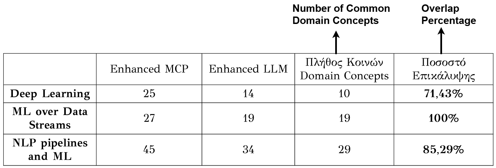

The results demonstrate the **superiority of the Enhanced MCP result sets (our approach)** in terms of the number of domain concepts for each examined DSL. Beyond this quantitative advantage, the Enhanced MCP result sets also cover, to a significant extent, the domain concepts identified in the corresponding Enhanced LLM result sets. Specifically, in the case of the Machine Learning over Data Streams DSL, a full coverage (100%) of the domain concepts of the Enhanced LLM by the Enhanced MCP is observed, while for the Deep Learning DSL and the NLP pipelines and Machine Learning DSL, the corresponding coverage percentages amount to 71.43% and 85.29%, respectively.

Since both result sets are generated using the same detailed prompt, the difference in domain concepts cannot be attributed to the formulation of the prompt. Therefore, **the superior performance of the Enhanced MCP is exclusively linked to the utilization of structured knowledge provided by the Knowledge Graph**. Furthermore, **the provision of this additional knowledge enables the language model** to go beyond the explicit instructions of the prompt and **to formulate functional requirements that cover broader aspects of the machine learning domain**.

## Conclusion
The results of both the subjective and objective evaluation demonstrate the clear superiority of our approach over the standalone LLM. These findings confirm that the Knowledge Graph contains rich domain knowledge for the broader field of Machine Learning, which significantly supports the language model in generating highly specialized FRs.

Consequently, our approach can serve as a useful tool for both Domain experts and DSL experts. For Domain experts, it can be used as a complementary tool, supporting the generation of functional requirements rich in domain concepts. Similarly, for DSL experts, our approach can substitute the role of Domain experts during the process of defining the functional requirements of a DSL.

---
## Future Work
- The system’s parsers extract both code structure and comments. Although comment analysis was not required in this work, future extensions could leverage **topic modeling techniques**, such as BERTopic, to extract additional domain knowledge from code comments.
- Supporting additional programming languages through **new parsers** would extend the current implementation (Python, C, C++, Java, JavaScript) and enable knowledge extraction from repositories written in newer or less common languages (e.g., Rust, Go, Kotlin).
- The concept filter mechanism can be improved by **enriching the existing stopword and common code word lists**, as the current predefined JSON-based approach is not exhaustive and may allow noise to be introduced into the results.
- The use of **indexes in the Knowledge Graph** would improve scalability and performance, enabling efficient query execution even as the graph grows to millions of concepts and relationships.
